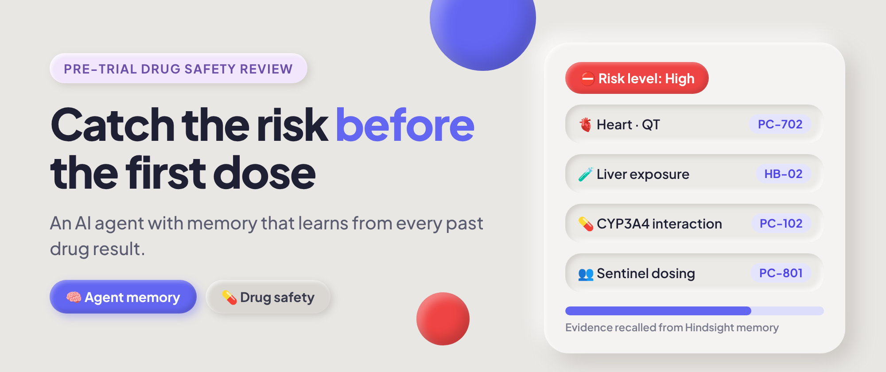
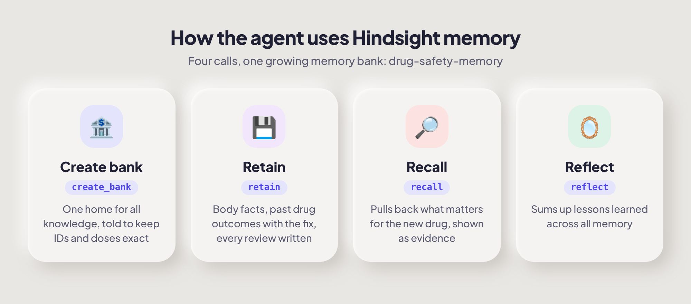

# TrialSleuth AI

**Check a drug before any human takes it.** TrialSleuth reviews a drug candidate before its first human trial against everything it remembers: how the human body handles drugs, what went wrong with past drugs, and the change that fixed it each time. It flags risks by body system and suggests concrete changes to the drug or the trial. Every new lab or trial result makes the next review better.

**Live demo:** https://trialsleuthai.streamlit.app/



## Demo video

[](https://youtu.be/1VzfxNN22gw)

▶️ **[Watch the demo on YouTube](https://youtu.be/1VzfxNN22gw)**

## Team

Listed in the order the work happened: research → build → content → video.

| Step | Member | Role | Write-up |
| --- | --- | --- | --- |
| 1 | Neelam Geethika Reddy ([@ngeethika15](https://github.com/ngeethika15)) | Research: drug-safety domain and use case | [How I built TrialSleuth AI](https://dev.to/ngeethika15/how-i-built-trialsleuth-ai-simulating-clinical-trial-safety-before-exposing-human-participants-4e05) |
| 2 | Soha Patel ([@Sohapatel-26](https://github.com/Sohapatel-26)) | Build: agent, Hindsight memory, Streamlit app | [Catch the Risk Before the First Dose](https://dev.to/sohapatel26/catch-the-risk-before-the-first-dose-building-an-ai-drug-safety-reviewer-that-remembers-npo) |
| 3 | Yashoda ([@yashodha23](https://github.com/yashodha23)) | Content: articles and posts | _coming soon_ |
| 4 | Riya Ranjan ([@riyaranjan56-new](https://github.com/riyaranjan56-new)) | Demo video | _coming soon_ |

## The problem

Before a new drug reaches the market it goes through human trials. Even with animal testing first, some participants are still harmed by problems that, looking back, were predictable: a liver risk seen before in a similar molecule, a heart-rhythm risk from a known chemical feature, a dangerous interaction with a common medicine, or a whole group dosed on the same morning.

That knowledge exists, but it is scattered across past trials, papers and people's heads. A plain AI chatbot reads only what you paste in and forgets it afterwards.

TrialSleuth gives the review a memory, built on [Hindsight](https://github.com/vectorize-io/hindsight). It does **not** predict a drug's exact effect or declare a drug safe; it makes sure known risks are designed out before anyone is dosed, and experts make the final call.

## How Hindsight memory is used



| Hindsight call | What TrialSleuth does with it | Where |
| --- | --- | --- |
| `create_bank` | One growing memory bank, `drug-safety-memory`, told to keep IDs, doses and percentages exact | `memory.ensure_bank` |
| `retain` | Stores human-body knowledge (tag `body`), past drug outcomes with the change that worked (tag `past-drug`), and a summary of every review the agent writes (tag `review`) | `memory.save_body_fact`, `save_past_drug`, `save_review` |
| `recall` | For each candidate, recalls the relevant body knowledge, similar past drugs and earlier reviews. The right-hand panel shows exactly what was recalled | `memory.recall` |
| `reflect` | "What has the agent learned?" summarises lessons across everything in memory | `memory.reflect` |

**Before vs after memory** (the demo):
- *Memory OFF:* a plain AI reviews HLV-772 with no history and gives generic advice.
- *Memory ON:* it cites past outcomes, for example KRAS inhibitor liver injury at 800 mg (PC-101) and the CYP3A4 interaction (PC-102). It suggests a 400 mg start dose, weekly liver tests, banning strong CYP3A4 inhibitors, excluding Child-Pugh B patients and sentinel dosing (HB-14).
- *After learning:* save the new result PC-702 (a sister compound blocked the heart's hERG channel). The next review of HLV-772 now flags a heart-rhythm risk and asks for hERG testing before dosing.

## Architecture

```
Company submits drug candidate (Streamlit form)
        |
        v
   agent.py --recall--> Hindsight memory bank
        |               (body knowledge + past drug outcomes + earlier reviews)
        v                        ^
   Groq LLM (gpt-oss-120b)       | retain: seed_data.py, "Teach the agent a new result",
        |                        |         and every review summary
        v
 Risk report by body system + suggested changes  -->  expert safety review
```

## Project files

| File | Job |
| --- | --- |
| `app.py` | Streamlit screen: candidate form and report, recalled-memory panel, memory on/off, "Teach the agent a new result" |
| `agent.py` | Recalls memories and asks Groq for a risk report that cites memory IDs |
| `memory.py` | All Hindsight calls: bank, retain, recall, reflect |
| `seed_data.py` | Loads body knowledge and past drug outcomes (run once) |
| `data/human_body.json` | 14 human-body pharmacology facts |
| `data/past_compounds.json` | 9 past drug outcomes with the change that worked |
| `data/demo_candidate.json` | The demo candidate, HLV-772 |
| `data/demo_new_result.json` | PC-702, added live during the demo |

Drug names and outcomes are fictional, written for demonstration. The body facts are simplified summaries of standard pharmacology.

## Run it

Needs Python 3.10+, a [Hindsight Cloud](https://ui.hindsight.vectorize.io) API key and a [Groq](https://console.groq.com) API key.

```powershell
python -m venv venv
venv\Scripts\activate          # Mac: source venv/bin/activate
pip install -r requirements.txt
copy env.example .env          # Mac: cp env.example .env   then fill in your keys
python seed_data.py            # once: loads body knowledge + past drug outcomes
python agent.py                # optional terminal test
streamlit run app.py
```

## Demo script

1. Turn **Use Hindsight memory** OFF and click **Review before human trial**. Generic answer.
2. Turn memory ON and review again. The report cites PC-101, PC-102, HB-02, HB-14 and the right panel shows the recalled memories.
3. In the sidebar, click **Save result to memory** (PC-702 is pre-filled).
4. Review HLV-772 again. It now flags the heart-rhythm (hERG) risk from PC-702, and the panel shows the earlier review too.
5. Click **What has the agent learned?** to show `reflect` (takes 10 to 30 seconds).

PC-702 is intentionally left out of `seed_data.py`. To rerun the demo from scratch, set `HINDSIGHT_BANK` in `.env` to a new name and run `python seed_data.py` again (each run uses Hindsight credit).

## Limitations

- **Not a replacement for lab tests or trials.** It can only flag risks that its memory covers. A new kind of toxicity that nothing in memory resembles will not be caught.
- **Recall can miss or mismatch.** That is why every report cites IDs and the panel shows exactly what was used.
- **Memory quality matters.** A wrong result saved to memory would mislead later reviews; a real system needs review and versioning of what is retained.
- **Fictional data**, as noted above. A real deployment would need validated sources, an audit trail and regulatory validation.

## Learn more

- [Hindsight on GitHub](https://github.com/vectorize-io/hindsight)
- [Hindsight documentation](https://hindsight.vectorize.io/)
- [What is agent memory?](https://vectorize.io/what-is-agent-memory)
